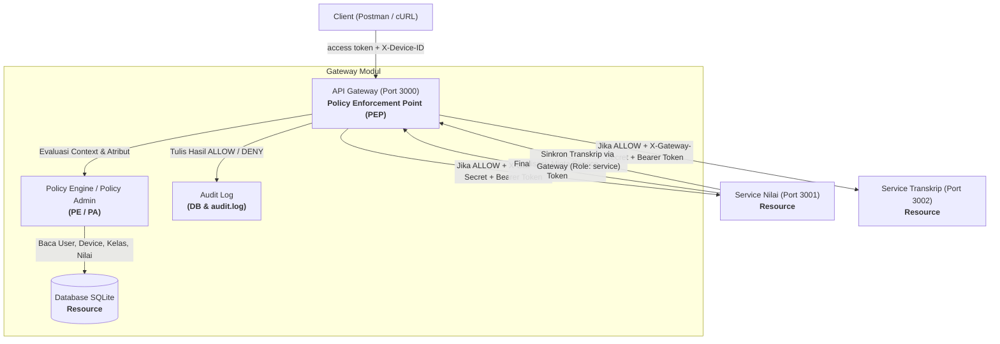

# Zero Trust Security

Sistem pengelolaan nilai dan transkrip akademik yang dibangun di atas prinsip Zero Trust Security sesuai standar NIST SP 800-207. Arsitektur ini menerapkan konsep Never Trust Always Verify, Least Privilege, dan Assume Breach secara penuh di tingkat aplikasi.

---

## Cara Menjalankan

### Prasyarat

- Node.js versi 18 atau lebih baru (direkomendasikan versi 20 LTS atau 24 LTS)
- npm

### Langkah Instalasi dan Menjalankan

```bash
# 1. Masuk ke direktori proyek
cd zero_trust

# 2. Instal seluruh dependensi
npm install

# 3. (Opsional) Isi ulang database dengan data awal
npm run seed

# 4. Jalankan seluruh service sekaligus
npm start
```

Setelah menjalankan perintah di atas, seluruh komponen akan aktif:

| Komponen | Alamat |
| :--- | :--- |
| API Gateway (PEP) | http://localhost:3000 |
| Service Nilai | http://localhost:3001 (akses langsung diblokir) |
| Service Transkrip | http://localhost:3002 (akses langsung diblokir) |

Catatan: Jika database kosong, seeding data awal akan dijalankan secara otomatis saat `npm start`.

### Menjalankan Pengujian Otomatis

```bash
npm test
```

Perintah ini akan menjalankan 30 skenario pengujian Zero Trust secara otomatis dan menampilkan hasilnya di terminal.

---

## Daftar Akun

Password untuk seluruh akun default adalah `password123`.

### Akun Pengguna

| No | Username | Password | Role | Identitas | Nama Lengkap |
|:--:| :--- | :--- | :---: | :---: | :--- |
| 1 | admin1 | password123 | admin | ADM001 | Administrator Akademik |
| 2 | dosen_fahri | password123 | dosen | 0401018001 | Dr. Fahri Hidayat, M.Kom. |
| 3 | dosen_siti | password123 | dosen | 0402028202 | Dr. Siti Aminah, M.T. |
| 4 | mhs_andi | password123 | mahasiswa | 227006001 | Andi Pratama |
| 5 | mhs_arhan | password123 | mahasiswa | 227006002 | Arhan Maulana |
| 6 | mhs_yuli | password123 | mahasiswa | 227006003 | Yuli Rahmawati |

### Service Client (Antar-Service)

| Client ID | Client Secret | Role Token |
| :--- | :--- | :---: |
| service-nilai | secret-service-nilai-xyz | service |

---

## Device ID Data Awal

Setiap akun pengguna memiliki satu perangkat terdaftar. Header `X-Device-ID` wajib disertakan pada setiap permintaan login. Permintaan login dari Device ID yang tidak terdaftar akan ditolak secara otomatis.

| Username | Device ID | Keterangan Perangkat |
| :--- | :---: | :--- |
| admin1 | DEV-ADMIN-01 | Laptop Admin ThinkPad |
| dosen_fahri | DEV-DOSEN-01 | MacBook Pro Dosen Fahri |
| dosen_siti | DEV-DOSEN-02 | Dell XPS Dosen Siti |
| mhs_andi | DEV-MHS-01 | Asus ROG Andi |
| mhs_arhan | DEV-MHS-02 | MacBook Air Arhan |
| mhs_yuli | DEV-MHS-03 | HP Pavilion Yuli |

---

## Arsitektur Sistem

Sistem terdiri dari tiga komponen utama yang berjalan secara bersamaan:

- **API Gateway (Port 3000)** -- satu-satunya pintu masuk. Berperan sebagai Policy Enforcement Point (PEP) yang memeriksa token JWT, Device ID terdaftar, mencatat audit log, dan meneruskan permintaan ke resource service disertai header `X-Gateway-Secret`.
- **Service Nilai (Port 3001)** -- mengelola data nilai dan kelas. Menolak akses langsung tanpa header `X-Gateway-Secret`.
- **Service Transkrip (Port 3002)** -- mengelola transkrip dan perhitungan IPK. Endpoint sinkronisasi hanya dapat dipanggil oleh token service internal.

---

## Data Awal Kelas dan Nilai

| ID Kelas | Kode MK | Mata Kuliah | SKS | Dosen Pengampu | Mahasiswa dan Nilai Awal |
|:--:| :---: | :--- | :---: | :--- | :--- |
| 1 | IF301 | Keamanan Informasi | 3 | Dr. Fahri Hidayat (dosen_fahri) | Andi Pratama: 85.5 (A), Arhan Maulana: 75.0 (B) |
| 2 | IF302 | Kriptografi | 3 | Dr. Siti Aminah (dosen_siti) | Arhan Maulana: 88.0 (A), Yuli Rahmawati: 82.0 (B) |

---

## Kebijakan Akses

| Endpoint | Role yang Diizinkan | Aturan |
| :--- | :---: | :--- |
| POST /auth/login | Semua pengguna | Kredensial valid dan Device ID terdaftar |
| POST /auth/refresh | Semua pengguna | Refresh token valid dan belum dicabut |
| POST /auth/logout | Semua pengguna | Mencabut refresh token aktif |
| POST /auth/service | Service Nilai | Client ID dan Client Secret valid |
| GET /nilai | Mahasiswa, Dosen | Mahasiswa hanya melihat nilai miliknya; dosen hanya melihat kelas yang diampu |
| PUT /nilai/:id | Dosen | Kelas diampu, nilai belum final, dalam jam akses 07.00-21.00 |
| POST /kelas/:id/finalisasi | Dosen | Kelas diampu, belum final, dalam jam akses |
| GET /transkrip/:nim | Mahasiswa, Admin | Mahasiswa hanya NIM miliknya; admin dapat melihat semua |
| POST /transkrip/sinkron | Token Service | Hanya token dengan role service yang diizinkan |

---

## Pengujian Manual via cURL

Contoh pengujian dasar menggunakan cURL:

```bash
# Login mahasiswa dengan device terdaftar
curl -i -X POST http://localhost:3000/auth/login \
  -H "Content-Type: application/json" \
  -H "X-Device-ID: DEV-MHS-01" \
  -d '{"username":"mhs_andi","password":"password123"}'

# Login dengan device tidak terdaftar (ditolak 403)
curl -i -X POST http://localhost:3000/auth/login \
  -H "Content-Type: application/json" \
  -H "X-Device-ID: DEV-TIDAK-TERDAFTAR" \
  -d '{"username":"mhs_andi","password":"password123"}'

# Akses langsung ke Service Nilai tanpa melewati Gateway (ditolak 403)
curl -i http://localhost:3001/nilai

# Melihat nilai (gunakan token dari hasil login)
curl -i -X GET http://localhost:3000/nilai \
  -H "Authorization: Bearer <ACCESS_TOKEN>" \
  -H "X-Device-ID: DEV-MHS-01"

# Melihat audit log
curl -i -X GET "http://localhost:3000/audit-logs?limit=10"
```

Koleksi Postman lengkap tersedia di `postman/Zero_Trust_API_Collection.json`.

---

## Struktur Direktori

```
zero_trust/
├── .env.example              # Contoh file konfigurasi lingkungan
├── package.json              # Dependensi dan skrip npm
├── index.js                  # Entry point utama, menjalankan seluruh service
├── src/
│   ├── config/
│   │   └── index.js          # Pemuatan konfigurasi terpusat
│   ├── database/
│   │   ├── connection.js     # Koneksi SQLite dan inisialisasi skema
│   │   └── seed.js           # Seeding data pengguna, perangkat, kelas, nilai
│   ├── gateway/
│   │   ├── index.js          # API Gateway (PEP) - Port 3000
│   │   ├── policy.js         # Policy Engine dan Policy Administrator (PE/PA)
│   │   └── audit.js          # Pencatat audit log ke database dan file
│   ├── services/
│   │   ├── nilai/
│   │   │   ├── index.js      # Resource Service Nilai - Port 3001
│   │   │   └── syncClient.js # Client antar-service ke Gateway Transkrip
│   │   └── transkrip/
│   │       └── index.js      # Resource Service Transkrip - Port 3002
│   └── shared/
│       └── authMiddleware.js # Middleware verifikasi Zero Trust
├── scripts/
│   ├── seedDb.js             # Skrip CLI seeding database
│   └── testRunner.js         # Automated test suite (30 skenario)
└── postman/
    └── Zero_Trust_API_Collection.json  # Koleksi Postman siap pakai
```


---

## 1. Ringkasan Eksekutif & Prinsip Zero Trust

Proyek ini mengimplementasikan sistem pengelolaan nilai dan transkrip mahasiswa akademik berbasis prinsip **Zero Trust Security** secara penuh di tingkat aplikasi (*application level*), mematuhi spesifikasi **NIST SP 800-207**.

### Tiga Pilar Inti Zero Trust:
1. **Never Trust, Always Verify:**
   - Tidak ada perimeter jaringan yang dipercaya secara *implicit*.
   - Setiap *request* wajib melalui API Gateway (PEP), membawa token JWT yang valid, dan header `X-Device-ID` yang terdaftar.
   - Resource services (Service Nilai & Service Transkrip) menolak *direct access* tanpa header rahasia `X-Gateway-Secret`.
2. **Least Privilege (Hak Akses Minimum):**
   - Mahasiswa hanya dapat melihat nilai dan transkrip miliknya sendiri (berdasarkan NIM).
   - Dosen hanya dapat melihat, mengubah, dan memfinalisasi nilai pada kelas yang diampunya.
   - Sinkronisasi transkrip (`POST /transkrip/sinkron`) dibatasi secara ketat hanya untuk Token Service internal; token user (bahkan dosen/admin) ditolak.
3. **Assume Breach:**
   - Resource Service tidak berasumsi bahwa API Gateway tidak pernah disusupi.
   - Setiap service melakukan verifikasi ulang (*defense-in-depth*) terhadap tanda tangan digital dan masa berlaku token JWT, meskipun request telah membawa `X-Gateway-Secret`.

---

## 2. Arsitektur Sistem (NIST SP 800-207)



### Tabel Komponen Sistem:

| Komponen | Peran NIST SP 800-207 | Port | Tanggung Jawab |
| :--- | :--- | :---: | :--- |
| **API Gateway** | **PEP** (*Policy Enforcement Point*) | `3000` | Satu-satunya pintu masuk. Memeriksa request, meminta evaluasi ke Policy Engine, mencatat audit log, dan meneruskan request ke resource service dengan header `X-Gateway-Secret`. |
| **Policy Engine / Policy Admin** | **PE / PA** (*Policy Engine / Policy Administrator*) | Modul Gateway | Menangani login, manajemen token JWT, mengevaluasi kebijakan RBAC/ABAC berdasarkan kepemilikan data, status finalisasi kelas, device terdaftar, dan jam akses (07.00–21.00). |
| **Service Nilai** | **Resource** | `3001` | Mengelola data nilai dan kelas. Menolak request tanpa `X-Gateway-Secret` atau tanpa token valid. Saat finalisasi kelas, memanggil Service Transkrip melalui Gateway. |
| **Service Transkrip** | **Resource** | `3002` | Mengelola transkrip akademik dan perhitungan IPK. Hanya mengizinkan sinkronisasi dari Token Service internal. |
| **Database** | **Resource** | File SQLite | Media penyimpanan bersama (`database.sqlite`) untuk data pengguna, device terdaftar, kelas, nilai, transkrip, refresh token, dan audit log. |
| **Audit Log** | **Data Source** | DB & File | Mencatat riwayat setiap keputusan akses (*timestamp, subject, endpoint, device, decision ALLOW/DENY, reason*). |

---

## 3. Data Awal Sistem (Seed Data)

Database secara otomatis diinisialisasi dengan data awal yang memenuhi ketentuan:
- Password untuk semua akun default: `password123`

### A. Tabel Pengguna & Device Terdaftar

| No | Username | Password | Role | Identitas (NIM/NIDN) | Nama Lengkap | Device ID Terdaftar | Keterangan Device |
|:--:| :--- | :--- | :---: | :---: | :--- | :---: | :--- |
| 1 | `admin1` | `password123` | `admin` | `ADM001` | Administrator Akademik | `DEV-ADMIN-01` | Laptop Admin ThinkPad |
| 2 | `dosen_fahri` | `password123` | `dosen` | `0401018001` | Dr. Fahri Hidayat, M.Kom. | `DEV-DOSEN-01` | MacBook Pro Dosen Fahri |
| 3 | `dosen_siti` | `password123` | `dosen` | `0402028202` | Dr. Siti Aminah, M.T. | `DEV-DOSEN-02` | Dell XPS Dosen Siti |
| 4 | `mhs_andi` | `password123` | `mahasiswa` | `227006001` | Andi Pratama | `DEV-MHS-01` | Asus ROG Andi |
| 5 | `mhs_arhan` | `password123` | `mahasiswa` | `227006002` | Arhan Maulana | `DEV-MHS-02` | MacBook Air Arhan |
| 6 | `mhs_yuli` | `password123` | `mahasiswa` | `227006003` | Yuli Rahmawati | `DEV-MHS-03` | HP Pavilion Yuli |

### B. Tabel Kelas & Pengampu

| ID Kelas | Kode MK | Mata Kuliah | SKS | Dosen Pengampu | Mahasiswa Terdaftar & Nilai Awal |
|:--:| :---: | :--- | :---: | :--- | :--- |
| `1` | `IF301` | Keamanan Informasi | 3 | Dr. Fahri Hidayat (`dosen_fahri`) | • Andi Pratama (85.5 / A)<br>• Arhan Maulana (75.0 / B) |
| `2` | `IF302` | Kriptografi | 3 | Dr. Siti Aminah (`dosen_siti`) | • Arhan Maulana (88.0 / A)<br>• Yuli Rahmawati (82.0 / B) |

### C. Client Antar-Service
- **Client ID:** `service-nilai`
- **Client Secret:** `secret-service-nilai-xyz`
- **Role Token:** `service` (Masa berlaku: 5 menit)

---

## 4. Matriks Kebijakan Akses (Policy Matrix)

| Endpoint | Ditangani Oleh | Role Diizinkan | Kondisi Kebijakan Zero Trust (PE/PA) |
| :--- | :---: | :---: | :--- |
| `POST /auth/login` | Gateway | Semua user | Kredensial valid dan header `X-Device-ID` terdaftar untuk user tersebut. Menghasilkan Access Token (10m) & Refresh Token (1d). |
| `POST /auth/refresh` | Gateway | Semua user | Refresh token ada di database, belum kedaluwarsa, dan belum dicabut (`revoked = 0`). |
| `POST /auth/logout` | Gateway | Semua user | Mencabut status refresh token di database (`revoked = 1`). |
| `POST /auth/service` | Gateway | Service Nilai | Client ID dan Client Secret valid. Menghasilkan Service Token (5m, `role: service`). |
| `GET /nilai` | Nilai (Port 3001) | Mahasiswa, Dosen | • **Mahasiswa:** hanya melihat nilai miliknya sendiri.<br>• **Dosen:** hanya melihat kelas yang diampunya. |
| `PUT /nilai/:id` | Nilai (Port 3001) | Dosen | Kelas yang diampu oleh dosen yang login, nilai belum difinalisasi, dan request dilakukan dalam jam akses (07.00–21.00). |
| `POST /kelas/:id/finalisasi` | Nilai (Port 3001) | Dosen | Kelas yang diampu dosen, kelas belum final, dan dalam jam akses. Memicu sinkronisasi nilai ke Service Transkrip via Gateway. |
| `GET /transkrip/:nim` | Transkrip (Port 3002) | Mahasiswa, Admin | • **Mahasiswa:** hanya NIM miliknya sendiri.<br>• **Admin:** berhak melihat semua NIM. |
| `POST /transkrip/sinkron` | Transkrip (Port 3002) | Service Nilai | **Hanya Token Service** (`role: service`). Token user (mahasiswa/dosen/admin) mana pun ditolak (403 Forbidden). |

---

## 5. Cara Menjalankan Sistem

### Prasyarat
- Node.js versi 18+ (disarankan Node.js 20 atau 24 LTS)
- npm

### Langkah Instalasi & Menjalankan:
```bash
# 1. Masuk ke direktori proyek
cd d:/zero_trust

# 2. Instalasi dependensi (jika belum)
npm install

# 3. Jalankan pengisian database awal (Seeding)
npm run seed

# 4. Jalankan seluruh service (Gateway, Service Nilai, Service Transkrip)
npm start
```

Output di terminal akan menampilkan:
```text
============================================================
  SISTEM NILAI & TRANSKRIP - ZERO TRUST SECURITY ARCHITECTURE
  Informatika Universitas Siliwangi (KP70065004)
============================================================
[SERVICE NILAI] Berjalan di port 3001
[SERVICE TRANSKRIP] Berjalan di port 3002
[API GATEWAY (PEP)] Berjalan di port 3000
============================================================
[STATUS] Seluruh komponen Zero Trust berjalan dengan baik:
  1. API Gateway (PEP)      : http://localhost:3000
  2. Service Nilai          : http://localhost:3001 (Direct access diblokir)
  3. Service Transkrip      : http://localhost:3002 (Direct access diblokir)
  4. Audit Log File         : audit.log
============================================================
```

---

## 6. Pengujian Otomatis (Automated Test Suite)

Untuk memverifikasi seluruh 30 skenario keamanan Zero Trust secara instan dengan 100% lulus:

```bash
npm test
```

Pengujian ini mencakup:
1. Perlindungan Direct Access (Bypass Gateway) -> HTTP 403 Forbidden
2. Prinsip Assume Breach pada Resource Service -> HTTP 401 Unauthorized
3. Validasi Device Terdaftar (`X-Device-ID`) -> HTTP 403 Device Unregistered
4. Lifecycle Token (Access Token, Refresh Token, Logout/Revocation)
5. Hak Akses Berbasis Atribut (ABAC) untuk Nilai Mahasiswa & Dosen
6. Kontrol Jam Akses (07.00 - 21.00)
7. Finalisasi Kelas & Panggilan Antar-Service Sinkronisasi Transkrip
8. Larangan Pengubahan Nilai Setelah Finalisasi
9. Hak Akses Transkrip (Mahasiswa NIM Sendiri vs Admin)
10. Proteksi Sinkronisasi Transkrip (Khusus Token Service)
11. Verifikasi Pencatatan Audit Log di Database & File

---

## 7. Panduan Pengujian Manual via cURL / Postman

Import file Postman Collection yang telah disediakan di:
`postman/Zero_Trust_API_Collection.json`

Berikut adalah contoh perintah `cURL` untuk demonstrasi:

### A. Uji Coba Direct Access ke Service (Bypass Gateway Ditolak)
```bash
# Mencoba akses langsung ke Service Nilai tanpa lewat Gateway (PORT 3001)
curl -i http://localhost:3001/nilai
# Hasil: HTTP 403 Forbidden (DIRECT_ACCESS_BLOCKED)
```

### B. Login User dengan Device Terdaftar
```bash
curl -i -X POST http://localhost:3000/auth/login \
  -H "Content-Type: application/json" \
  -H "X-Device-ID: DEV-MHS-01" \
  -d '{"username":"mhs_andi","password":"password123"}'
# Hasil: HTTP 200 OK (Mendapatkan accessToken & refreshToken)
```

### C. Login User dengan Device Tidak Terdaftar (Ditolak)
```bash
curl -i -X POST http://localhost:3000/auth/login \
  -H "Content-Type: application/json" \
  -H "X-Device-ID: DEV-HACKER" \
  -d '{"username":"mhs_andi","password":"password123"}'
# Hasil: HTTP 403 Forbidden (DEVICE_UNREGISTERED)
```

### D. Mahasiswa Melihat Nilai Miliknya
```bash
curl -i -X GET http://localhost:3000/nilai \
  -H "Authorization: Bearer <TOKEN_MHS_ANDI>" \
  -H "X-Device-ID: DEV-MHS-01"
# Hasil: HTTP 200 OK (Hanya menampilkan nilai mata kuliah Andi)
```

### E. Dosen Mengubah Nilai di Luar Jam Akses (Simulasi Jam 22.00)
```bash
curl -i -X PUT http://localhost:3000/nilai/1 \
  -H "Content-Type: application/json" \
  -H "Authorization: Bearer <TOKEN_DOSEN_FAHRI>" \
  -H "X-Device-ID: DEV-DOSEN-01" \
  -H "X-Simulate-Hour: 22" \
  -d '{"nilai_angka": 90}'
# Hasil: HTTP 403 Forbidden (OUTSIDE_ACCESS_HOURS)
```

### F. Dosen Finalisasi Kelas & Panggilan Antar-Service
```bash
curl -i -X POST http://localhost:3000/kelas/1/finalisasi \
  -H "Authorization: Bearer <TOKEN_DOSEN_FAHRI>" \
  -H "X-Device-ID: DEV-DOSEN-01" \
  -H "X-Simulate-Hour: 10"
# Hasil: HTTP 200 OK (Status final, otomatis sync ke Transkrip via Service Nilai -> Gateway -> Transkrip)
```

### G. Mahasiswa Mencoba Mengintip Transkrip Mahasiswa Lain
```bash
# Mahasiswa Andi (NIM: 227006001) mencoba melihat transkrip Arhan (NIM: 227006002)
curl -i -X GET http://localhost:3000/transkrip/227006002 \
  -H "Authorization: Bearer <TOKEN_MHS_ANDI>" \
  -H "X-Device-ID: DEV-MHS-01"
# Hasil: HTTP 403 Forbidden (NIM_MISMATCH)
```

### H. Memeriksa Audit Log
```bash
curl -i -X GET "http://localhost:3000/audit-logs?limit=10"
# Hasil: Menampilkan 10 keputusan akses terakhir beserta waktu, subjek, endpoint, device, dan alasannya.
```
